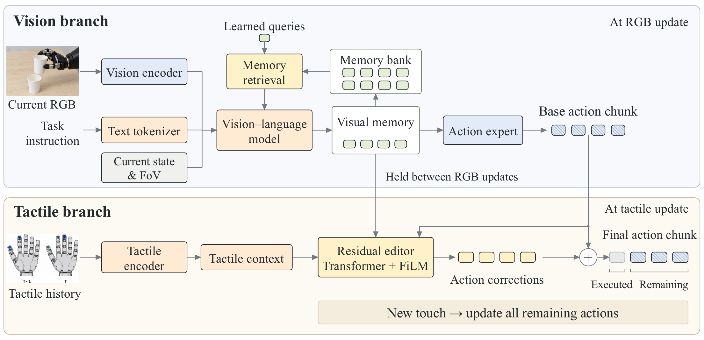

<div align="center">

# T-WLA

### Bridging Slow Vision and Fast Touch

**Shared visual memory connects visual planning with fast tactile correction.**

[](https://anonymous-submission-20.github.io/T-WLA.github.io/)
[](https://anonymous-submission-20.github.io/T-WLA.github.io/#robot)
[](#pretrained-weights)

[Overview](#overview) · [Quick Start](#quick-start) · [Pretrained Weights](#pretrained-weights) · [Training](#training) · [Inference](#inference) · [Evaluation](#evaluation) · [Citation](#citation)

</div>

<p align="center">
  <a href="https://anonymous-submission-20.github.io/T-WLA.github.io/#method">
    
  </a>
</p>
<p align="center"><em>Visual planning and tactile correction share a history-aware visual memory. Input thumbnails are illustrative.</em></p>

## Overview

**How can a robot respond to changing contact before its next visual update?**

Tactile feedback reveals local contact changes, but the appropriate response also depends on the task, scene, and ongoing motion. **T-WLA** is a world–language–action architecture that connects a visual policy and a lightweight tactile editor through **shared visual memory**.

- **Plan with visual history.** At each RGB update, retrieve past visual information and combine it with the current observation, instruction, state, and field of view to produce visual memory and a base action chunk.
- **Correct asynchronously with touch.** Between RGB updates, combine recent **tactile context** with the cached visual memory and base actions to predict residual corrections, without rerunning the visual branch.
- **Learn from future interaction.** Future-image and future-pressure prediction complement action supervision during training. Neither prediction head runs during action inference.

```text
corrected actions = original base actions + masked tactile residuals
```

Each tactile update revises only valid, unexecuted actions relative to the original plan. A new RGB update replaces the visual memory and base chunk.

The paper evaluates tactile-conditioned hand-motion prediction on **EgoTouch and Tachin**, visual-only prediction on **GigaHands, OakInk2, and TACO**, and four real-robot tasks: **egg transfer, single-sheet pickup, paper-cup nesting, and paper-bag dragging**. Reported results include a **30% reduction in EgoTouch finger-joint MPJPE** relative to the strongest reported baseline and **50.0% average robot success** with **30 demonstrations per task**. See the [project page](https://anonymous-submission-20.github.io/T-WLA.github.io/) for qualitative comparisons and robot videos.

This repository provides the **visual foundation model, tactile encoder pretraining, tactile-editor training, predictive objectives, baseline implementations, and robot hardware tools**.

## Quick Start

Use **Python ≥ 3.10** and a compatible **CUDA/PyTorch environment** for training. The tactile package requires **PyTorch ≥ 2.4**. From the repository root:

```bash
git clone https://github.com/kaichen-z/TWLA.git
cd TWLA
python -m pip install -r T-WLA_foundation_model/requirements.txt
python -m pip install -e './tactile_editor[test]'
```

For tactile-only development, the editable package is sufficient. Its unit tests run on CPU without downloading model weights:

```bash
python -m pytest tactile_editor/tests
```

| Goal | Start here |
| :--- | :--- |
| Use the pretrained visual policy | [Download weights](#pretrained-weights), then [run inference](#inference) |
| Train the full staged method | [Configure data](#configuration), then follow [Training](#training) |
| Train the tactile editor on frozen visual predictions | [Editor training](#3-train-the-tactile-editor) |
| Set up calibration, teleoperation, or recording | [Robot hardware guide](robot_hardware/README.md) |

## Pretrained Weights

| Component | Hugging Face | File |
| :--- | :--- | :--- |
| Visual policy | [T-WLA-FD](https://huggingface.co/anon-submission-0518/T-WLA-FD) | `T-WLA-FD.pt` |
| RGB world head | [T-WLA-WM](https://huggingface.co/anon-submission-0518/T-WLA-WM) | `T-WLA-WM.pt` |
| EgoTouch P1 tactile encoder, H8 | [MANO-aligned H8](https://huggingface.co/MIT-Media-Lab/egotouch-tactile-encoder-p1-v1/tree/main/mano-aligned-v1/h8) | `mano-aligned-v1/h8/best.pt` |
| SmolVLA baseline | [T-WLA-baseline-SmolVLA](https://huggingface.co/anon-submission-0518/T-WLA-baseline-SmolVLA) | `SmolVLA.pt` |
| VITRA baseline | [T-WLA-baseline-VITRA](https://huggingface.co/anon-submission-0518/T-WLA-baseline-VITRA) | `VITRA.pt` |
| MemoryVLA baseline | [T-WLA-baseline-MemoryVLA](https://huggingface.co/anon-submission-0518/T-WLA-baseline-MemoryVLA) | `MemoryVLA.pt` |

Download the visual policy, RGB world head, and H8 encoder from the repository root using the [Hugging Face CLI](https://huggingface.co/docs/huggingface_hub/guides/cli):

```bash
hf download anon-submission-0518/T-WLA-FD T-WLA-FD.pt \
  --local-dir checkpoints
hf download anon-submission-0518/T-WLA-WM T-WLA-WM.pt \
  --local-dir checkpoints
hf download MIT-Media-Lab/egotouch-tactile-encoder-p1-v1 \
  mano-aligned-v1/h8/best.pt mano-aligned-v1/h8/resolved_config.json \
  --local-dir checkpoints/egotouch-p1
```

The H8 release provides a **formal P1 encoder checkpoint**, distinct from the same repository's standalone safetensors exports. Match its history length, coordinate convention, and normalization to your cache; see [checkpoint compatibility](docs/reproduction-notes.md#checkpoint-compatibility).

The encoder initializes tactile feature extraction; it is **not** a trained residual editor. Train the editor with the workflow below. No final W3 editor download is currently linked in this release.

## Configuration

Set external data, output, and pretrained-asset locations:

```bash
export VLA_DATA=/path/to/prepared_data
export VLA_RUNS=/path/to/training_outputs
export VLA_WEIGHTS=/path/to/third_party_weights
```

| Stage | Configuration / required input |
| :--- | :--- |
| Visual training | [`configs/train.json`](T-WLA_foundation_model/configs/train.json): dataset roots, split lists, statistics, JPEG frame stores, model assets |
| Encoder pretraining | [`encoder_p1_h8.json`](tactile_editor/configs/encoder_p1_h8.json): format-v4 EgoTouch cache, output directory, OpenTouch initialization checkpoint |
| EgoTouch editor | Paired30 cache, training statistics, matching formal P1 encoder, RGB world checkpoint and configuration |
| Native Tachin editor | Native-sensor cache, `statistics.npz`, recording-disjoint audit, RGB world checkpoint and configuration |

Use absolute paths for external inputs. Downloaded weights do not replace prepared data or frozen visual-prediction caches. **Future-image supervision requires valid `jpeg_root` frame stores**; the raw-video fallback reuses the current frame and is not suitable for future-image training. Cache formats and additional asset requirements are described in the [tactile guide](tactile_editor/README.md#cache-and-time-contract) and [reproduction notes](docs/reproduction-notes.md#data-and-cache-preparation).

## Training

The released workflow uses **staged optimization**:

| Stage | What is trained | Supervision |
| :--- | :--- | :--- |
| Visual branch | Visual controller and configured RGB-prediction components | Action flow matching + future-image prediction |
| Tactile encoder | Tactile and pose encoders | Paired tactile/hand-pose contrastive learning |
| Tactile editor, `w3` | Tactile encoder, residual editor, RGB conditioning adapter, pressure predictor | Corrected-action loss + residual penalty + RGB/pressure prediction |

During editor training, the visual controller supplies frozen cached memory and base actions. The RGB predictor stays frozen; its tactile adapter and the pressure predictor are trained.

### 1. Train the visual branch

Edit the visual configuration, then run:

```bash
cd T-WLA_foundation_model
torchrun --nproc_per_node=4 train.py --config configs/train.json \
  --init-world-from ../checkpoints/T-WLA-WM.pt
cd ..
```

`--init-world-from` initializes only the RGB world head. To initialize the visual controller as well, add `--init-from /path/to/visual_checkpoint.pt`. Use `--resume /path/to/run_checkpoint.pt` to continue an existing run. Adjust the GPU count and training budget to your setup.

### 2. Prepare the tactile encoder

Use a compatible pretrained H8 checkpoint from [Pretrained Weights](#pretrained-weights), or train your own. For pretraining, edit `cache_root`, `output_dir`, and the OpenTouch initialization `checkpoint` in the encoder configuration, then run from the repository root:

```bash
python -m egotouch_formal.train \
  --config tactile_editor/configs/encoder_p1_h8.json
```

The resulting formal P1 `best.pt` is used by the EgoTouch editor's `--encoder-checkpoint` argument. Native Tachin uses its own sensor encoder and does not take this argument.

### 3. Train the tactile editor

With a prepared EgoTouch cache and matching checkpoints, run from the repository root:

```bash
python tactile_editor/scripts/train_paired30.py \
  --root /path/to/paired30_cache --variant w3 \
  --encoder-checkpoint /path/to/compatible_encoder_h8/best.pt \
  --world-checkpoint checkpoints/T-WLA-WM.pt \
  --world-config /path/to/matching_world_config.json \
  --lambda-rgb 0.1 --lambda-tactile 0.0001 \
  --output-dir /path/to/runs/w3 --validation-only
```

The auxiliary coefficients are example settings. Use `--smoke-steps 2` for a short, data-dependent check. Keep `--validation-only` during model selection; omitting it also evaluates the selected checkpoint on the test cache.

<details>
<summary><strong>Native Tachin training</strong></summary>

```bash
python tactile_editor/scripts/train_tachin.py \
  --cache /path/to/tachin_cache --model twla \
  --world-checkpoint checkpoints/T-WLA-WM.pt \
  --world-config /path/to/matching_world_config.json \
  --lambda-rgb 0.1 --lambda-tactile 0.0001 \
  --output /path/to/runs/tachin_w3
```

Tachin uses the native 880-cell sensor layout. The runner evaluates the test split after selecting the best validation checkpoint. Before using extended paired30 caches, read the [elapsed-time limitation](docs/reproduction-notes.md#native-tachin-timing).

</details>

<details>
<summary><strong>Baselines and predictive-loss ablations</strong></summary>

For standard tactile baselines, use `--variant smolvla`, `vitra`, `memoryvla`, or `trex` on EgoTouch, or the corresponding `--model` on Tachin. **Omit both auxiliary-weight flags and W3-only encoder/world arguments**; each runner disables predictive objectives internally. Use matching backbone caches.

For W3 ablations, retain `--variant w3` / `--model twla` and change the auxiliary weights:

| Setting | `--lambda-rgb` | `--lambda-tactile` |
| :--- | :--- | :--- |
| Both predictions | Positive | Positive |
| Without image prediction | `0` | Positive |
| Without pressure prediction | Positive | `0` |
| Without both predictions | `0` | `0` |

Disabled branches do not execute. Zero RGB weight removes the requirement for the RGB world checkpoint/config and RGB-only cache fields. These are editor-stage ablations, not changes to earlier visual pretraining. See the [tactile guide](tactile_editor/README.md) for details.

</details>

## Inference

Run Python from `T-WLA_foundation_model/` with a matching visual checkpoint and configuration:

```python
from inference.policy import VLAPolicy, to_canvas, fov_from_intrinsics

policy = VLAPolicy(
    checkpoint="../checkpoints/T-WLA-FD.pt",
    instruction="Left hand: None. Right hand: pick up the cup.",
)

# Supply an RGB image, state/mask, camera intrinsics, and episode identifier.
base_actions, visual_memory = policy.act(
    to_canvas(rgb), state, state_mask,
    fov_from_intrinsics(fx, fy, cx, cy), episode_id,
    steps=16, return_mf=True,
)
```

The supplied configuration returns a **16 × 192 action chunk** and **8 × 960 visual memory**. `state` and `state_mask` each have 212 dimensions; actions are returned in physical coordinates. Visual history resets when the episode identifier changes or `policy.reset()` is called.

For tactile correction, [`policy_context(...)`](tactile_editor/src/tactile_editor/public_backbone.py) converts the visual output into the editor's normalized input space using explicit training statistics and action-validity masks. The intended execution cycle is:

1. **RGB update:** generate and cache visual memory and the base chunk.
2. **Tactile update:** encode recent touch and predict a masked residual for the remaining actions, using the original base chunk as reference.
3. **Next RGB update:** replace the cached memory and chunk; tactile updates never modify the visual memory bank.

Apply robot-specific action conversion, limits, and safety checks before execution. Calibration, teleoperation, recording, and device interfaces are in [`robot_hardware/`](robot_hardware/README.md); the library interfaces are not a complete asynchronous robot scheduler.

## Evaluation

For visual-policy diagnostics:

```bash
cd T-WLA_foundation_model
torchrun --nproc_per_node=2 eval_test.py --config configs/train.json \
  --checkpoint ../checkpoints/T-WLA-FD.pt --out test.json
cd ..
```

Tactile evaluation measures **wrist translation error**, **wrist rotation geodesic error**, and **wrist-relative finger-joint MPJPE**. Paper comparisons use a common prediction horizon, per-sequence averages, and an equal-weight average across EgoTouch's five environments.

The [physical metric utilities](tactile_editor/src/tactile_editor/table1_experiment.py) implement this strict horizon and aggregation protocol. The default EgoTouch runner and visual evaluator report separate diagnostic reductions, so their output should not be substituted directly for paper-table values. See [evaluation and timing notes](docs/reproduction-notes.md#evaluation-protocol) before reproducing comparisons.

## Outputs

Training saves artifacts to the output directory selected in the configuration or command:

| Stage | Main artifacts |
| :--- | :--- |
| Tactile encoder | `best.pt`, `last.pt`, `resolved_config.json`, `metrics.jsonl`, `summary.json` |
| EgoTouch editor | `best.pt`, `last.pt`, `config.json`, `epochs.jsonl`; `validation_summary.json` with `--validation-only`, otherwise `summary.json` and test predictions |
| Native Tachin editor | `best.pt`, `last.pt`, `config.json`, `epochs.jsonl`, `summary.json`, and test predictions |
| Visual evaluation | Diagnostic JSON at the path supplied to `--out` |

Retain the checkpoint, configuration, and matching cache/statistics identity together. A `--smoke-steps` run writes a smoke report and is not a completed training run.

## Release Scope

The core implementation includes **visual planning, tactile encoder pretraining, frozen-visual editor training, predictive losses, baseline editors, evaluation utilities, and hardware tools**. Visual-policy, RGB-world-head, and tactile-encoder weights are linked above.

- **Data:** provide prepared datasets, caches, split definitions, and normalization statistics; raw-recording preprocessing is external.
- **Editor weights:** the training pipeline produces editor checkpoints; this release does not yet link a final pretrained W3 editor.
- **Extensions:** joint visual–tactile fine-tuning is a proposed extension, not part of the released offline training workflow. Robot adaptation and a complete asynchronous deployment/timing pipeline require additional integration.

Implementation-specific details are collected in [Reproduction Notes](docs/reproduction-notes.md).

## Code Map

| Path | Responsibility |
| :--- | :--- |
| [`T-WLA_foundation_model/TWLA/`](T-WLA_foundation_model/TWLA/) | Visual memory, retrieval, and action expert |
| [`T-WLA_foundation_model/world_model/`](T-WLA_foundation_model/world_model/) | Future-image prediction |
| [`T-WLA_foundation_model/inference/`](T-WLA_foundation_model/inference/) | Stateful visual-policy inference |
| [`tactile_editor/src/egotouch_formal/`](tactile_editor/src/egotouch_formal/) | Tactile/pose encoder pretraining |
| [`tactile_editor/src/tactile_editor/`](tactile_editor/src/tactile_editor/) | Residual editor, predictive heads, backbone adapters, and metrics |
| [`tactile_editor/scripts/`](tactile_editor/scripts/) | EgoTouch and native Tachin training |
| [`tactile_editor/tests/`](tactile_editor/tests/) | Encoder, editor, mask, loss, and interface tests |
| [`robot_hardware/`](robot_hardware/) | Calibration, teleoperation, recording, and hardware interfaces |

## Acknowledgments

This work builds on SmolVLA/LeRobot, SmolVLM2, EgoTouch/OpenTouch, SANA, DC-AE, VITRA, and MemoryVLA. Please follow each upstream model and dataset's access and licensing terms. See [dependencies and attribution](docs/reproduction-notes.md#dependencies-and-attribution) for details.

## Citation

If you find T-WLA useful, please cite the project. This entry uses the project page; no arXiv identifier or publication venue is assumed.

```bibtex
@misc{twla2026,
  title = {{T-WLA}: Bridging Slow Vision and Fast Touch},
  year  = {2026},
  url   = {https://anonymous-submission-20.github.io/T-WLA.github.io/}
}
```

---

<p align="center">
  <a href="https://anonymous-submission-20.github.io/T-WLA.github.io/">Project Page</a> ·
  <a href="https://anonymous-submission-20.github.io/T-WLA.github.io/#method">Method Overview</a> ·
  <a href="https://anonymous-submission-20.github.io/T-WLA.github.io/#robot">Robot Demonstrations</a>
</p>
